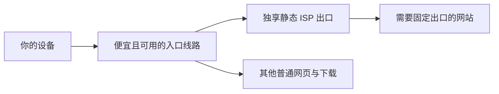

# 2026 静态 ISP 推荐｜六大知名厂商、用户点评与链式代理配置

<strong>六大知名商家 · 单 IP 月付 · 真实来源点评 · Clash Verge 链式配置</strong>

**从几美元月付到企业级套餐，把静态 ISP 的价格门槛、独享区别、流量限制和用户吐槽一次讲透。** 六家主流厂商放在一起比较，再搭配便宜且可用的入口线路，让固定出口配置从购买到上手都有章可循。

适合想买 **1 个 IP、租 1 个月**，用于网页、ChatGPT、Claude 等服务的读者。本仓库是资料整理与配置指南，没有商家线路实测。

**配套仓库：[VPN-suggestions](https://github.com/OXWWXO/VPN-suggestions)**。入口负责接入，ISP 负责固定出口；普通流量走入口。本仓库商家入口使用官方直达链接，不加推广参数。

> 更新：2026-10-15。美元价格与税费以当前结算页为准。部分历史点评另标日期；共享起价、每 IP 单价、套餐最低实付不能混为一谈。

[挑商家](#六大知名-isp-商家直达) · [看别人怎么说](#别人怎么说优点和吐槽一起看) · [学链式配置](docs/clash-verge.md) · [查原始证据](docs/evidence.md)

## 第一次接触静态 ISP，按这个顺序读

本仓库是一份购买与配置指南，**不是代理服务或可直接运行的客户端**。下载仓库不会获得可用 IP；示例中的 `.invalid`、`CHANGE_ME` 都需要换成你自己的参数。

| 阶段 | 要完成的事 | 对应文档 |
| --- | --- | --- |
| 了解概念 | 分清入口、出口、固定地址和独享，确认自己需要什么 | [新手上手：术语与准备](docs/getting-started.md#先分清这些名称) |
| 购买前 | 核对目标国家、一个月总价、流量与退款条件 | [商家对比](#六大知名-isp-商家直达)、[官方证据](docs/evidence.md) |
| 拿到参数 | 找到主机、SOCKS5 端口、凭据和真正的出口 IP | [准备清单](docs/getting-started.md#开始前准备好什么) |
| 配置 | 在图形界面、扩展脚本和独立 YAML 中选一种 | [配置方式选择](docs/getting-started.md#选择一种配置方式)、[字段说明](examples/README.md) |
| 验收 | 核对规则、代理链、固定出口和实际服务操作 | [完成后的验收](docs/getting-started.md#完成后的验收) |
| 排错 | 按入口、认证、规则、网站的顺序定位 | [故障排查](docs/troubleshooting.md) |

**最短上手路线：** 先验证已有入口能用 → 确认 ISP 产品支持目标用途 → 取得 SOCKS5 参数 → 按 [图形配置](docs/clash-verge.md#图形界面配置)建立入口到 ISP 的链 → 在连接面板确认目标请求走链 → 核对实际出口和服务操作。尚未购买的读者先看费用与条款，再选产品。

首页价格和点评保留各自的来源与日期；本次新增的新手文档不代表重新核验所有商家的实时库存、结算价或线路可用性。

## 六大知名 ISP 商家直达

名单综合品牌覆盖、公开文档与第三方评测可见度选取，**不宣称全球知名度前六，也没有官方“权威排名”**。企业级品牌与适合个人小额购买是两回事。

| 商家 / 官方产品入口 | 独享套餐参考 | 实付门槛与注意点 | 更适合谁 |
| --- | --- | --- | --- |
| **[Bright Data](https://brightdata.com/pricing/proxy-network/isp-proxies)** | 10 个独享 IP **$35/月** | **$3.50/IP 不等于能单买 $3.50**；共享 10 个 $18 是另一档；100GB/IP/月 FUP，超额可能收费 | 企业管理功能、批量购买 |
| **[Oxylabs](https://oxylabs.io/pricing/dedicated-isp-proxies)** | 当前页面独享 **$3/IP**，Starter **$30/月** | 页面已展示统一订阅/产品额度；不要把 $3 当作最低实付。旧 5 IP $16 记录不再作为当前推荐价 | 企业服务、ASN 选择 |
| **[Decodo（原 Smartproxy）](https://decodo.com/proxies/isp-proxies/pricing)** | 3 个独享 IP **$9.99/月＋税** | 少量套餐仍需买 3 个；$0.27 起是不同格式和条件，不能代替独享报价 | 需要几个 IP、重视自助管理 |
| **[Webshare](https://www.webshare.io/dedicated-static-residential-proxy)** | 独享页面展示 20 个 IP **$42/月** | 平均 $2.10/IP；可定制数量须后台核价，不能推断单 IP 同价。Private 可能共享，选 Dedicated；流量档需单独核对 | 批量和自定义套餐 |
| **[IPRoyal](https://iproyal.com/pricing/static-residential-proxies/)** | 30 天官网 **$2.70/IP 起**；本次用户后台反馈 **$4** | $4 未取得美国结算截图；100GB/IP/30 天；额外要求和流量可能收费 | 单 IP 月付、需要用量统计 |
| **[Proxy-Seller](https://proxy-seller.com/isp/)** | 支持 1 IP；本次用户截图日本 **$3/月** | **美国待核价**；默认 FUP 约 100GB/IP、100 并发；超额后的具体 Mbps 未公布 | 单 IP 小额月付、按地区比价 |

### 如果你只买一个月、一个 IP

先核对 **IPRoyal 和 Proxy-Seller 的目标国家结算价及网站兼容范围**。若只用一个出口，别为了品牌知名度盲买 3、10 或 20 个 IP；Webshare 的自定义数量另查后台，企业品牌也可能有按量或新的额度选项。

六家的价格是可核对的入口，不能替代真实测试。更多流量规则与价格变化见 [官方证据](docs/evidence.md)。早期整理中的小众低价名单已退出首页推荐，避免把未核实的低价商家与主流品牌混排。

## 别人怎么说：优点和吐槽一起看

以下均为**他人的评价摘要**，不是本仓库自己的测评。评测网站可能使用推广链接；用户评论是个例，样本与用途不统一。详情与日期见 [六家点评档案](docs/reviews.md)。

| 商家 | 有参考价值的好评 / 评测判断 | 短板 / 用户反馈 |
| --- | --- | --- |
| **Bright Data** | Proxyway 认为平台功能和企业管理工具丰富。[评测](https://proxyway.com/reviews/bright-data-proxies) | 同评测提醒价格和上手复杂度；2026-10 Trustpilot 有客服处理拖延投诉，商家回复称问题已解决。[评论及回复](https://www.trustpilot.com/review/brightdata.com) |
| **Oxylabs** | Proxyway 将其列为企业取向头部厂商；2026-10-12 用户 Anto R. 对 ISP 和客服给出好评。[用户评论](https://www.trustpilot.com/review/oxylabs.io) | 一句好评没有样本与地区，不能推出所有节点表现；当前付费结构对只买单 IP 的读者需要仔细算总额 |
| **Decodo** | Proxyway 评价其功能、价格、自助体验较均衡。[评测](https://proxyway.com/reviews/smartproxy-proxies) | 同评测说明不同 ISP 格式计费不同；独享入门 3 IP，不是单 IP 价格。基础性能评测不能当 AI 账号测试 |
| **Webshare** | Proxyway 认可自助定制和价格灵活。[评测](https://proxyway.com/reviews/webshare-proxies) | 用户报告独享静态代理访问 Reddit 出现 403，但其他网站可用；这不能推断 ChatGPT / Claude 同样不通。[原帖](https://www.reddit.com/r/proxies/comments/1uy02t5/getting_reddit_403s_with_webshare_static/) |
| **IPRoyal** | 有美国 ISP 用于 ChatGPT / Claude 的个人成功记录。[使用记录](https://kerrynotes.com/ai-traffic-routing/) | 有连接、评分和售后投诉；静态 ISP 不等于永远“零风险”。[美国 ISP 用户讨论](https://www.reddit.com/r/proxies/comments/1qu301b/2_years_with_iproyal_and_i_feel_completely/) |
| **Proxy-Seller** | 有 ISP 用户称问题及时得到客服解决。[用户好评](https://www.trustpilot.com/review/proxy-seller.com?page=8) | 美国纽约 ISP 用户投诉维护换 IP；另有 FUP 超额限流争议。[评价](https://www.trustpilot.com/review/proxy-seller.com?page=2) · [FUP 讨论](https://www.reddit.com/r/proxies/comments/1w75x4x/warning_proxysellers_hidden_100gb_fup_policy_zero/) |

## 便宜入口 + 固定出口，怎么组合

选择入口时，先找**最低成本但白天、晚高峰都能正常连接**的套餐，再用 ISP 作为最后一跳。没必要只为入口的共享出口额外付“住宅解锁”溢价，但入口带宽、稳定性、端口限制仍重要。

[VPN-suggestions 价格表](https://github.com/OXWWXO/VPN-suggestions#all-prices)在 2026-10-02 整理中列了吹雪云约 2 元/月、良心云约 2 元/月等低价参考。其中部分是宣传或历史评测价格，**未在本次重新验证当前结算与可用性**。使用前读它们的运营商限制、流量倍率与原资料。链接所在仓库含带邀请码的入口，读者可自行选择官方无邀请码地址。

总成本 = 入口套餐实付 + ISP 单 IP 实付 + 附加费用。不要把季付、年付折算价当成能直接买一个月的价格。美元换算按付款时汇率和手续费计算。

链路速度取决于最慢一段，增加一跳也会增加延迟；ISP 不能修复入口本身不通的问题。普通 SOCKS5 不自带加密，不建议把明文 SOCKS5 凭据直接暴露在不可信网络中；本地到入口使用加密代理，目标网站使用 HTTPS。

## 配置入口

1. **新手首选：[Clash Verge Rev 图形配置](docs/clash-verge.md#图形界面配置)**，对应“订阅 → 编辑节点 → 配置代理链”。
2. **保留原订阅分流：[全局扩展脚本](examples/clash-verge-script.js)**，只添加 ISP、入口选择组与指定服务域名规则。
3. **独立配置：[Mihomo YAML 模板](examples/mihomo-chain.example.yaml)**，适合有代理节点订阅 URL 的读者。
4. **连接不通：[故障排查](docs/troubleshooting.md)**，先核对出口和链路，再区分网站、认证和账号问题。

下载客户端只从 [Clash Verge Rev 官方 GitHub](https://github.com/clash-verge-rev/clash-verge-rev/releases) 获取。图形链式功能按官方文档要求 **v2.4.5 或更新**。

## 购买前确认

- 是 1 个固定、独享的 **IPv4 ISP**，不是动态住宅、共享 ISP 或仅固定网关。
- 美国 / 日本有库存，30 天总价、最低充值与续费价是什么。
- 服务商是否允许访问目标网站；不可访问时的更换、退款时限与流量条件是什么。
- FUP、并发、带宽、到期保留 IP、维护换 IP、自动续费是否明确。

买一个月，收到后尽快测试。能打开首页不代表能登录、发消息、上传文件或运行客户端；代理也不会改变服务的地区资格与使用条款。

## 维护与验证

配置逻辑检查：`node tests/config.test.cjs`。YAML 还需使用自己的 Mihomo 内核 `mihomo -t -f config.yaml` 做语法校验；替换占位符后再启用。我们验证模板结构与脚本行为，不宣称已验证商家实际线路。

2026-10-15 发布前验证：Node.js 24 脚本检查通过；Mihomo v1.19.32 对替换为保留测试 IP、离线本地 provider 的 YAML，以及脚本生成配置执行 `-t` 均通过。没有用真实商家凭据或节点做连接测试。

提交更正时附：官网页面、查询日期、国家、数量、租期、附加项、总价与 FUP。不要附账号、密码、订阅链接、订单截图里的个人资料。详见 [贡献指南](CONTRIBUTING.md)。
