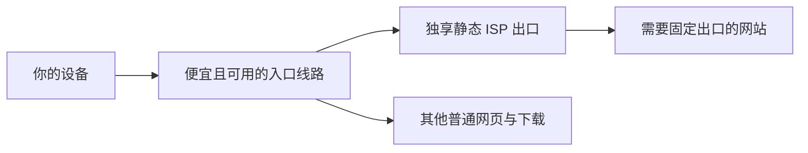

# 静态 ISP 推荐与链式代理指南

**买一个独享静态 ISP，再配一条便宜、在自己网络上可用的入口线路。** 普通流量走入口，需要固定出口的网站走 ISP：入口负责接入，ISP 负责固定出口。

适合想买 **1 个 IP、租 1 个月**，用于网页、ChatGPT、Claude 等服务的读者。本文是资料整理与配置指南，没有进行商家线路实测，也不承诺账号稳定性或网站长期可用。

**配套仓库：[VPN-suggestions](https://github.com/OXWWXO/VPN-suggestions)**，查入口线路的套餐、限制和原评测。本仓库不使用代理商推广链接。

> 核查日期：2026-10-14。价格均为美元，人民币入口价格另行注明。官网起价不等于美国单 IP 结算价，税费、最低充值、国家和附加服务另算。

## 快速选择

| 目标 | 先比较 | 理由 |
| --- | --- | --- |
| 尽量压低成本 | Proxy-Cheap、Geonix、MarsProxies | 有接近 $3 的月付页面报价，单 IP 条件相对容易核对 |
| 比较美国独享 ISP | Evomi Private、IPRoyal、Proxy-Seller | 注意 Evomi 的 $1 是共享；IPRoyal 实际单 IP 可能高于宣传起价 |
| 愿意试更小众的低价商家 | Proxynet | 基础档 $1.80/IP/月，但最低充值、美国库存、目标访问附加项仍需确认 |
| 更重视企业服务 | Oxylabs、Decodo、Bright Data | 品牌和文档可比较；不要为只用一个 IP 盲买批量套餐 |

## 单 IP 月付价格表

下表按公开参考报价排列，**不是线路质量排名，也不是“已经实付验证”的最低价榜**。商品名称中的 static、ISP、private、dedicated 必须一起核对，尤其要确认网站看到的出口 IP 固定且独享。

| 商家 / 产品 | 月价参考 | 是否独享 | 单 IP / 美国结算状态 | 主要限制与来源 |
| --- | ---: | --- | --- | --- |
| [Proxynet ISP](https://proxynet.io/static-isp-residential-proxy/pricing) | $1.80/IP/月基础档 | 官网称独享 | 未核对最终付款门槛及库存 | 单 IP 默认约 15Mbps；所有网站访问 +$0.50，高速 +$1；$1 需 $300 余额档 |
| [Evomi Private ISP](https://evomi.com/product/static-residential) | $2.50/IP/月起 | 是 | 美国 Ashburn / AT&T 展示；最低数量未核实 | Shared $1 不独享；Virgin $4.50 起。产品页称不限量，尚未完整核实 FUP |
| [Geonix ISP](https://geonix.com/isp/) | 30 天默认配置 $2.70/IP | 是 | 有美国选项，默认报价不是美国核价 | Proxy-Sale 原 ISP 链接现跳转此站；流量与 FUP 需结账前复核 |
| [Proxy-Cheap Static Residential IPv4](https://www.proxy-cheap.com/services/static-residential-proxies) | 1 Month $2.71 | 是 | 官网支持单 IP；美国运营商价格待选 | 标注 100+Mbps、100+ threads、不限流量；FUP 未完整核实 |
| [MarsProxies ISP](https://marsproxies.com/proxies/unmetered-residential-proxies/) | 1 IP $2.99 | 是 | 支持 30 天，有美国；国家结算价待选 | 100GB/IP/月额度，订单合并计算；不要用 $1.35 起价代替单月单 IP |
| [Proxy-Seller ISP](https://proxy-seller.com/isp/) | 本次会话日本截图 $3/月；美国待核价 | 是 | 支持 1 IP；日本价格不当作美国报价 | FUP 默认约 100GB/IP、100 并发；超额降速数值未查明 |
| [IPRoyal ISP](https://iproyal.com/pricing/static-residential-proxies/) | 官网 $2.70 起；会话用户后台反馈 $4 | 是 | $4 是用户反馈，未取得美国结算截图 | 100GB/IP/30 天；独享超额降速，可买额外流量；附加要求可能收费 |

其他值得知道的门槛：[Webshare 独享](https://www.webshare.io/dedicated-static-residential-proxy)页面 20 个 IP $42/月；[Decodo 独享](https://decodo.com/proxies/isp-proxies/pricing)页面 3 个 $9.99/月加税；[Oxylabs 独享](https://oxylabs.io/pricing/dedicated-isp-proxies)产品专页展示 5 个 $16/月，价格页面之间可能有不同报价，以后台为准。

更多起价陷阱、官方 FUP 与评价见 [资料与证据](docs/evidence.md)。IP 评分是第三方判断，不是 ChatGPT / Claude 官方检测结果。

## 便宜入口 + 固定出口，怎么组合

选择入口时，先找**最低成本但白天、晚高峰都能正常连接**的套餐，再用 ISP 作为最后一跳。没必要只为入口的共享出口额外付“住宅解锁”溢价，但入口带宽、稳定性、端口限制仍重要。

[VPN-suggestions 价格表](https://github.com/OXWWXO/VPN-suggestions#all-prices)在 2026-10-02 整理中列了吹雪云约 2 元/月、良心云约 2 元/月等低价参考。其中部分是宣传或历史评测价格，**未在本次重新验证当前结算与可用性**。使用前读它们的运营商限制、流量倍率与原资料。链接所在仓库含带邀请码的入口，读者可自行选择官方无邀请码地址。

总成本 = 入口套餐实付 + ISP 单 IP 实付 + 附加费用。不要把季付、年付折算价当成能直接买一个月的价格。美元换算按付款时汇率和手续费计算。

链路速度取决于最慢一段，增加一跳也会增加延迟；ISP 不能修复入口本身不通的问题。普通 SOCKS5 不自带加密，不建议把明文 SOCKS5 凭据直接暴露在不可信网络中；本地到入口使用加密代理，目标网站使用 HTTPS。

## 配置入口

1. **新手首选：[Clash Verge Rev 图形配置](docs/clash-verge.md#图形界面配置)**，对应“订阅 → 编辑节点 → 配置代理链”。
2. **保留原订阅分流：[全局扩展脚本](examples/clash-verge-script.js)**，只添加 ISP、入口选择组与指定服务域名规则。
3. **独立配置：[Mihomo YAML 模板](examples/mihomo-chain.example.yaml)**，适合有代理节点订阅 URL 的读者。
4. **连接不通：[故障排查](docs/troubleshooting.md)**，先核对出口和链路，再区分网站、认证和账号问题。

下载客户端只从 [Clash Verge Rev 官方 GitHub](https://github.com/clash-verge-rev/clash-verge-rev/releases) 获取。图形链式功能按官方文档要求 **v2.4.5 或更新**。

## 购买前确认

- 是 1 个固定、独享的 **IPv4 ISP**，不是动态住宅、共享 ISP 或仅固定网关。
- 美国 / 日本有库存，30 天总价、最低充值与续费价是什么。
- 服务商是否允许访问目标网站；不可访问时的更换、退款时限与流量条件是什么。
- FUP、并发、带宽、到期保留 IP、维护换 IP、自动续费是否明确。

买一个月，收到后尽快测试。能打开首页不代表能登录、发消息、上传文件或运行客户端；代理也不会改变服务的地区资格与使用条款。

## 维护与验证

配置逻辑检查：`node tests/config.test.cjs`。YAML 还需使用自己的 Mihomo 内核 `mihomo -t -f config.yaml` 做语法校验；替换占位符后再启用。我们验证模板结构与脚本行为，不宣称已验证商家实际线路。

2026-10-15 发布前验证：Node.js 24 脚本检查通过；Mihomo v1.19.32 对替换为保留测试 IP、离线本地 provider 的 YAML，以及脚本生成配置执行 `-t` 均通过。没有用真实商家凭据或节点做连接测试。

提交更正时附：官网页面、查询日期、国家、数量、租期、附加项、总价与 FUP。不要附账号、密码、订阅链接、订单截图里的个人资料。详见 [贡献指南](CONTRIBUTING.md)。
